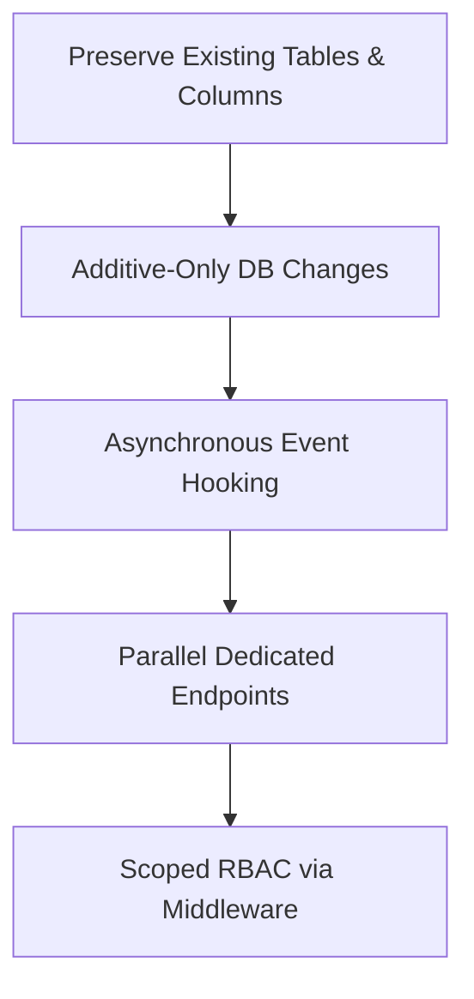
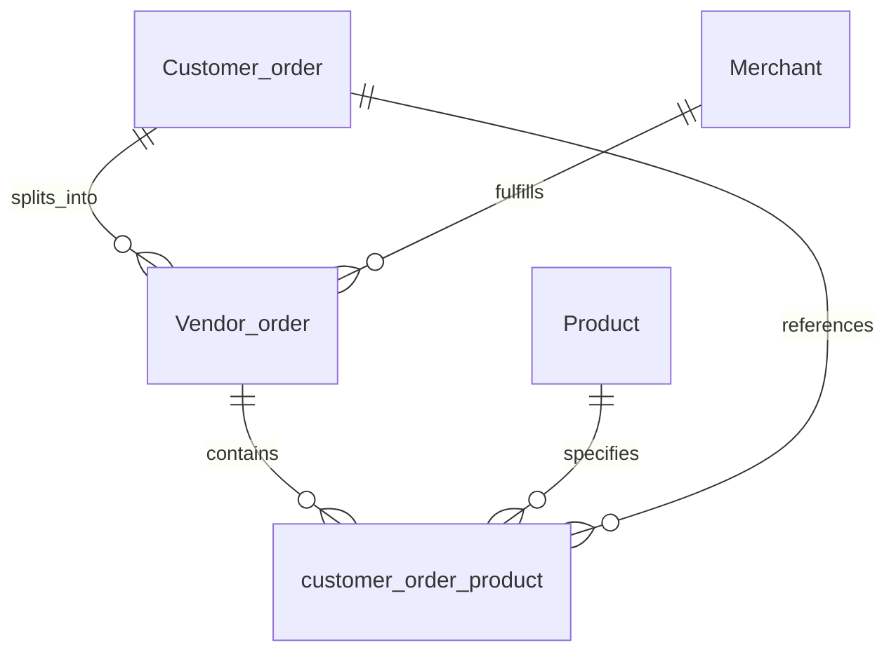
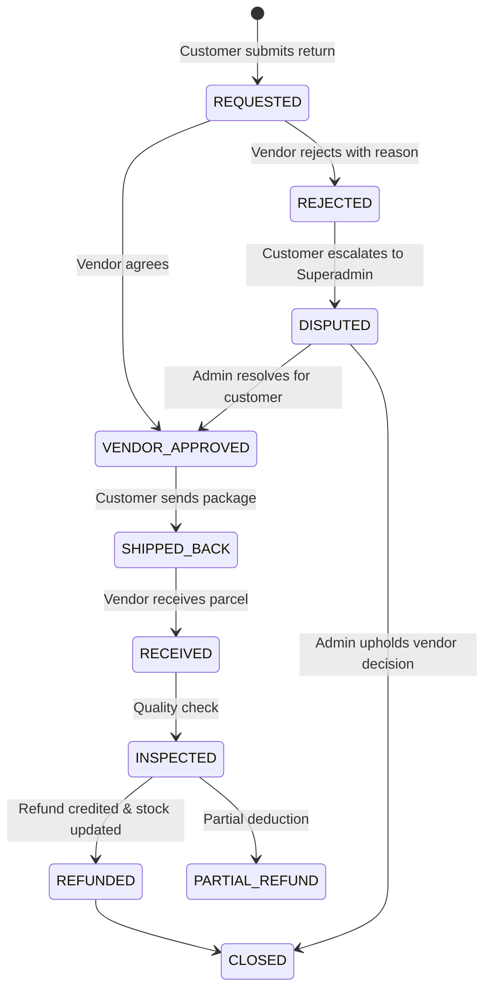

# Architecture & Development Specification: Multi-Vendor Marketplace & Return Management System

> **Application**: Electronics eCommerce Shop with Admin Dashboard  
> **Stack**: Next.js 15 (App Router, React 18, TailwindCSS, Zustand), Node.js (Express 4, CommonJS), MySQL, Prisma ORM 6.16.  
> **Core Constraint**: **Zero disruption to existing features, schema, and API contracts.**

---

## Table of Contents
1. [Executive Audit of the Existing Codebase](#1-executive-audit-of-the-existing-codebase)
2. [Zero-Disruption Architectural Principles](#2-zero-disruption-architectural-principles)
3. [Multi-Vendor Marketplace Architecture](#3-multi-vendor-marketplace-architecture)
   - [3.1 Data Model Extensions](#31-data-model-extensions)
   - [3.2 Authentication & Role-Based Access Control (RBAC)](#32-authentication--role-based-access-control-rbac)
   - [3.3 Order Splitting & Vendor Sub-Orders](#33-order-splitting--vendor-sub-orders)
   - [3.4 Vendor Dashboard & Management Scope](#34-vendor-dashboard--management-scope)
4. [Order Returns & RMA (Return Merchandise Authorization) System](#4-order-returns--rma-system)
   - [4.1 Return Lifecycle State Machine](#41-return-lifecycle-state-machine)
   - [4.2 RMA Data Model](#42-rma-data-model)
   - [4.3 Customer Return Flow](#43-customer-return-flow)
   - [4.4 Vendor & Admin Resolution Flow](#44-vendor--admin-resolution-flow)
   - [4.5 Inventory Restocking & Refund Settlement](#45-inventory-restocking--refund-settlement)
5. [Prisma Schema Migration (Safe & Non-Breaking)](#5-prisma-schema-migration-safe--non-breaking)
6. [Backend API Specifications & Code Patterns](#6-backend-api-specifications--code-patterns)
7. [Frontend Architecture & Page Routes](#7-frontend-architecture--page-routes)
8. [Phased Implementation Roadmap](#8-phased-implementation-roadmap)
9. [Risk Mitigation & Backward Compatibility Checklist](#9-risk-mitigation--backward-compatibility-checklist)

---

## 1. Executive Audit of the Existing Codebase

An analysis of the current repository reveals a modular, well-organized architecture that provides a strong foundation for both multi-vendor scaling and return management:

### Existing Architectural Assets
1. **Catalog Already Merchant-Aware**:
   - In [`prisma/schema.prisma`](file:///c:/Users/lokes/Desktop/Electronics-eCommerce-Shop-With-Admin-Dashboard-NextJS-NodeJS/prisma/schema.prisma), `Product` already includes a mandatory `merchantId` pointing to the `Merchant` model.
   - Products are already created with an assigned `merchantId` in [`server/controllers/products.js`](file:///c:/Users/lokes/Desktop/Electronics-eCommerce-Shop-With-Admin-Dashboard-NextJS-NodeJS/server/controllers/products.js).
   - An admin interface for merchants already exists under `app/(dashboard)/admin/merchant` and Express routes [`server/routes/merchant.js`](file:///c:/Users/lokes/Desktop/Electronics-eCommerce-Shop-With-Admin-Dashboard-NextJS-NodeJS/server/routes/merchant.js).
2. **Decoupled Client & Server Architecture**:
   - Frontend runs Next.js on port 3000, interacting via [`lib/api.ts`](file:///c:/Users/lokes/Desktop/Electronics-eCommerce-Shop-With-Admin-Dashboard-NextJS-NodeJS/lib/api.ts).
   - Backend is an Express server on port 3001 with centralized logging, error handling, and rate limiting.
3. **Existing Order Flow**:
   - Checkout in [`app/checkout/page.tsx`](file:///c:/Users/lokes/Desktop/Electronics-eCommerce-Shop-With-Admin-Dashboard-NextJS-NodeJS/app/checkout/page.tsx) creates a parent `Customer_order` first, then sequentially calls `/api/order-product` to create individual `customer_order_product` rows.
   - Notification subsystem (`Notification` model and helper utilities) is already integrated into the order lifecycle.

### Existing Gaps for Multi-Vendor & Returns
1. **No Vendor User Linkage**: The `Merchant` table has company details (name, email, phone) but no associated `User` record or login credentials. Vendors cannot log in; only superadmins can log in with `role: "admin"`.
2. **Single Monolithic Order Status**: `Customer_order` has a single `status` field (e.g., `pending`, `processing`, `delivered`). In a multi-vendor cart where a buyer buys items from Merchant A and Merchant B simultaneously, one vendor shipping their item cannot change the status without affecting the entire order.
3. **No Returns / RMA Mechanism**: There is no database entity, API route, or UI view for requesting, approving, tracking, or refunding returned items.

---

## 2. Zero-Disruption Architectural Principles

To ensure that **none of the existing functionality breaks** during or after this upgrade, all development must adhere to the following 5 rules:



1. **Strictly Additive Schema Changes**:
   - **Never** drop or rename existing tables (`Customer_order`, `customer_order_product`, `Product`, `User`, `Merchant`).
   - Any new fields added to existing models must be **optional (`?`)** or have a safe **default value**.
   - Foreign keys pointing to new tables must be nullable.
2. **Immutable Checkout & Customer API Contracts**:
   - Keep `POST /api/orders` and `POST /api/order-product` accepting their exact current payload signatures.
   - Multi-vendor order splitting and vendor notifications are executed as **side-effects / post-save hooks** in the backend, completely transparent to the existing checkout UI.
3. **Parallel Endpoint Namespace**:
   - Keep existing `/api/orders`, `/api/products`, `/api/merchants` intact.
   - Introduce `/api/vendor/*` for vendor-scoped catalog and order management.
   - Introduce `/api/returns/*` for customer return requests and vendor/admin RMA handling.
4. **Independent Vendor Portal Route**:
   - Keep `/admin/*` protected for superadmins (`role: "admin"`).
   - Introduce `/vendor/*` (or dynamic role-filtered dashboard views) protected for `role: "vendor"`.
5. **Graceful Fallback & Feature Flags**:
   - If a product belongs to a legacy merchant without an assigned user account, the platform superadmin retains full fallback control.

---

## 3. Multi-Vendor Marketplace Architecture

### 3.1 Data Model Extensions

To turn passive `Merchant` entries into active, self-service vendors:

1. **Link `User` to `Merchant`**:
   - Add `merchantId String?` to the `User` model (or `userId String?` to `Merchant`).
   - Add `"vendor"` as an allowed `User.role` (alongside `"user"` and `"admin"`).
   - This allows a user to log in with NextAuth, receive a JWT token containing `role: "vendor"` and `merchantId: "..."`, and be scoped to their store.

2. **Multi-Vendor Order Partitioning (`Vendor_order` / Sub-Order)**:
   - When a customer places an order containing items from multiple merchants, the parent `Customer_order` represents the customer's payment and receipt.
   - A new child table, `Vendor_order` (or `sub_order`), splits the order per merchant:



| Field in `Vendor_order` | Type | Description |
| :--- | :--- | :--- |
| `id` | `String @id @default(uuid())` | Unique Sub-Order ID |
| `customerOrderId` | `String` | References parent `Customer_order(id)` |
| `merchantId` | `String` | References `Merchant(id)` |
| `status` | `String @default("pending")` | Vendor fulfillment status (`pending`, `confirmed`, `shipped`, `delivered`, `cancelled`) |
| `subtotal` | `Int` | Total cost of items from this vendor |
| `commissionRate` | `Float @default(0.10)` | Marketplace commission percentage (e.g., 10%) |
| `payoutAmount` | `Int` | Net amount owed to the vendor (`subtotal - commission`) |
| `payoutStatus` | `String @default("unpaid")` | `unpaid`, `in_escrow`, `paid` |
| `trackingNumber` | `String?` | Courier tracking code entered by the vendor |
| `carrier` | `String?` | Shipping courier name (DHL, FedEx, UPS, etc.) |
| `shippedAt` | `DateTime?` | When vendor dispatched the package |

### 3.2 Authentication & Role-Based Access Control (RBAC)

#### NextAuth Callback Enhancement ([`app/api/auth/[...nextauth]/route.ts`](file:///c:/Users/lokes/Desktop/Electronics-eCommerce-Shop-With-Admin-Dashboard-NextJS-NodeJS/app/api/auth/%5B...nextauth%5D/route.ts))
Extend NextAuth JWT and session callbacks so they include `merchantId`:
```typescript
// In authorize()
if (isPasswordCorrect) {
  return {
    id: user.id,
    email: user.email,
    role: user.role,
    merchantId: user.merchantId || null, // <- Non-breaking addition
  };
}

// In callbacks.jwt()
if (user) {
  token.role = user.role;
  token.id = user.id;
  token.merchantId = (user as any).merchantId;
}

// In callbacks.session()
if (token) {
  session.user.role = token.role as string;
  session.user.id = token.id as string;
  session.user.merchantId = token.merchantId as string | undefined;
}
```

#### Frontend Middleware Protection ([`middleware.ts`](file:///c:/Users/lokes/Desktop/Electronics-eCommerce-Shop-With-Admin-Dashboard-NextJS-NodeJS/middleware.ts))
Maintain existing admin protections while adding vendor portal guard:
```typescript
export default withAuth(
  function middleware(req) {
    const role = req.nextauth.token?.role;
    // Superadmin route protection (Existing behavior unchanged)
    if (req.nextUrl.pathname.startsWith("/admin")) {
      if (role !== "admin") {
        return NextResponse.redirect(new URL("/", req.url));
      }
    }
    // New: Vendor route protection
    if (req.nextUrl.pathname.startsWith("/vendor")) {
      if (role !== "vendor" && role !== "admin") {
        return NextResponse.redirect(new URL("/login", req.url));
      }
    }
  },
  {
    callbacks: {
      authorized: ({ token, req }) => {
        if (req.nextUrl.pathname.startsWith("/admin")) {
          return !!token && token.role === "admin";
        }
        if (req.nextUrl.pathname.startsWith("/vendor")) {
          return !!token && (token.role === "vendor" || token.role === "admin");
        }
        return true;
      },
    },
  }
);

export const config = {
  matcher: ["/admin/:path*", "/vendor/:path*"]
};
```

#### Backend Express Authorization Middleware
Create [`server/middleware/authMiddleware.js`](file:///c:/Users/lokes/Desktop/Electronics-eCommerce-Shop-With-Admin-Dashboard-NextJS-NodeJS/server/middleware/authMiddleware.js):
```javascript
const { AppError } = require("../utills/errorHandler");

function requireRole(...allowedRoles) {
  return (req, res, next) => {
    // Read role passed from frontend API client header or session token
    const userRole = req.headers["x-user-role"] || req.user?.role;
    if (!userRole || !allowedRoles.includes(userRole)) {
      return res.status(403).json({ error: "Access denied. Insufficient permissions." });
    }
    next();
  };
}

function requireMerchantScope(req, res, next) {
  const merchantId = req.headers["x-merchant-id"] || req.user?.merchantId;
  const userRole = req.headers["x-user-role"] || req.user?.role;

  // Superadmins bypass vendor isolation
  if (userRole === "admin") return next();

  if (!merchantId) {
    return res.status(403).json({ error: "Vendor context required." });
  }

  req.merchantId = merchantId;
  next();
}

module.exports = { requireRole, requireMerchantScope };
```

### 3.3 Order Splitting & Vendor Sub-Orders (Zero Disruption)

Currently, [`app/checkout/page.tsx`](file:///c:/Users/lokes/Desktop/Electronics-eCommerce-Shop-With-Admin-Dashboard-NextJS-NodeJS/app/checkout/page.tsx) creates:
1. `Customer_order` via `POST /api/orders`
2. Each item via `POST /api/order-product`

#### Seamless Hook in `server/controllers/customer_order_product.js`:
Whenever `createOrderProduct` is called, we add an asynchronous helper `syncVendorOrder(customerOrderId, productId, quantity)`:
```javascript
async function syncVendorOrder(customerOrderId, productId, quantity) {
  try {
    const product = await prisma.product.findUnique({
      where: { id: productId },
      select: { merchantId: true, price: true }
    });

    if (!product || !product.merchantId) return;

    const itemSubtotal = product.price * quantity;
    const defaultCommission = 0.10; // 10% marketplace fee

    // Find or create the Vendor_order for this merchant & order combination
    let vendorOrder = await prisma.vendor_order.findFirst({
      where: {
        customerOrderId: customerOrderId,
        merchantId: product.merchantId
      }
    });

    if (!vendorOrder) {
      await prisma.vendor_order.create({
        data: {
          customerOrderId: customerOrderId,
          merchantId: product.merchantId,
          status: "pending",
          subtotal: itemSubtotal,
          commissionRate: defaultCommission,
          payoutAmount: Math.round(itemSubtotal * (1 - defaultCommission)),
          payoutStatus: "unpaid"
        }
      });
    } else {
      const updatedSubtotal = vendorOrder.subtotal + itemSubtotal;
      await prisma.vendor_order.update({
        where: { id: vendorOrder.id },
        data: {
          subtotal: updatedSubtotal,
          payoutAmount: Math.round(updatedSubtotal * (1 - vendorOrder.commissionRate))
        }
      });
    }
  } catch (err) {
    // Non-blocking log: order creation never fails due to background sub-order sync
    console.error("Warning: Vendor order sync error:", err);
  }
}
```
**Outcome**:
- Checkout process in `app/checkout/page.tsx` continues without changing a single line of client code.
- Sub-orders are reliably computed in real-time in the background.

---

## 4. Order Returns & RMA (Return Merchandise Authorization) System

### 4.1 Return Lifecycle State Machine



### 4.2 RMA Data Model

Two new models in `prisma/schema.prisma`: `Return_request` and `Return_item`:

```prisma
enum ReturnStatus {
  REQUESTED
  VENDOR_APPROVED
  REJECTED
  DISPUTED
  SHIPPED_BACK
  RECEIVED
  INSPECTED
  REFUNDED
  CLOSED
}

enum ReturnReason {
  DEFECTIVE
  DAMAGED_IN_SHIPPING
  WRONG_ITEM_SENT
  DOES_NOT_MATCH_DESCRIPTION
  CHANGED_MIND
  OTHER
}

model Return_request {
  id              String         @id @default(uuid())
  returnNumber    String         @unique // e.g., "RMA-2026-XXXX"
  customerOrderId String
  customerOrder   Customer_order @relation(fields: [customerOrderId], references: [id], onDelete: Cascade)
  merchantId      String
  merchant        Merchant       @relation(fields: [merchantId], references: [id], onDelete: Cascade)
  userId          String
  user            User           @relation(fields: [userId], references: [id], onDelete: Cascade)

  status          ReturnStatus   @default(REQUESTED)
  reason          ReturnReason
  customerComment String?        @db.Text
  vendorNotes     String?        @db.Text
  adminNotes      String?        @db.Text
  
  // Tracking & Shipping
  trackingNumber  String?
  returnCarrier   String?
  
  // Financials
  refundAmount    Int            @default(0) // In currency cents or integer currency units
  isRestocked     Boolean        @default(false)
  
  // Return items
  items           Return_item[]

  createdAt       DateTime       @default(now())
  updatedAt       DateTime       @updatedAt

  @@index([customerOrderId])
  @@index([merchantId])
  @@index([userId])
  @@index([status])
}

model Return_item {
  id              String         @id @default(uuid())
  returnRequestId String
  returnRequest   Return_request @relation(fields: [returnRequestId], references: [id], onDelete: Cascade)
  productId       String
  product         Product        @relation(fields: [productId], references: [id], onDelete: Cascade)
  quantity        Int            @default(1)
  itemPrice       Int            // Price at time of purchase
  condition       String?        // "UNOPENED", "OPEN_BOX", "DAMAGED"

  @@index([returnRequestId])
  @@index([productId])
}
```

### 4.3 Customer Return Flow
1. **Order Lookup**: Logged-in customer visits `/account/orders` and clicks **Request Return** next to an eligible order.
2. **Item & Reason Selection**: Customer chooses which product(s) to return, the quantity, the return reason (`DEFECTIVE`, `DAMAGED_IN_SHIPPING`, etc.), and adds an optional explanation or image URL.
3. **Submission**: Calls `POST /api/returns`, which creates a `Return_request` grouped by the product's `merchantId`. If an order contains items from two different vendors, two separate RMA requests are created so each vendor can process their respective item.
4. **Notification**: Both the vendor and the customer receive real-time notifications via the existing `Notification` subsystem.

### 4.4 Vendor & Admin Resolution Flow
1. **Vendor Action**: The vendor logs into `/vendor/returns`, reviews the request, and selects **Approve Return** (providing return shipping instructions) or **Reject Return** (providing a reason).
2. **Customer Shipping**: Once approved, customer marks the return as shipped and enters the tracking number (`PUT /api/returns/:id/ship`).
3. **Vendor Receipt & Inspection**: Vendor marks the package as **Received** and **Inspected**.
4. **Dispute Resolution (Superadmin)**: If a customer disputes a rejected return, it escalates to `DISPUTED`. The superadmin views this in `/admin/returns` and can issue an override or uphold the rejection.

### 4.5 Inventory Restocking & Refund Settlement
When the vendor completes the return inspection with status `REFUNDED`:
```javascript
// Automatically restore inventory in a transaction
await prisma.$transaction([
  // Restock products
  ...returnRequest.items.map(item => 
    prisma.product.update({
      where: { id: item.productId },
      data: { inStock: { increment: item.quantity } }
    })
  ),
  // Update Return status
  prisma.return_request.update({
    where: { id: returnRequestId },
    data: { status: "REFUNDED", isRestocked: true }
  }),
  // Deduct from Vendor_order payout
  prisma.vendor_order.updateMany({
    where: {
      customerOrderId: returnRequest.customerOrderId,
      merchantId: returnRequest.merchantId
    },
    data: {
      payoutAmount: { decrement: returnRequest.refundAmount }
    }
  })
]);
```

---

## 5. Prisma Schema Migration (Safe & Non-Breaking)

Here is the exact diff to add to [`prisma/schema.prisma`](file:///c:/Users/lokes/Desktop/Electronics-eCommerce-Shop-With-Admin-Dashboard-NextJS-NodeJS/prisma/schema.prisma) and [`server/prisma/schema.prisma`](file:///c:/Users/lokes/Desktop/Electronics-eCommerce-Shop-With-Admin-Dashboard-NextJS-NodeJS/server/prisma/schema.prisma). Notice that **every new relation on existing models is nullable/optional**, guaranteeing zero migration errors on existing database rows:

```prisma
// -------------------------------------------------------------
// 1. UPDATE EXISTING "User" MODEL: Add optional merchantId & returnRequests
// -------------------------------------------------------------
model User {
  id                String         @id @default(uuid())
  email             String         @unique
  password          String?
  role              String?        @default("user") // "user" | "admin" | "vendor"
  Wishlist          Wishlist[]
  notifications     Notification[]
  bulkUploadBatches bulk_upload_batch[] @relation("UserBatches")

  // NEW: Optional merchant association for vendor accounts
  merchantId        String?
  merchant          Merchant?      @relation("MerchantUser", fields: [merchantId], references: [id], onDelete: SetNull)

  // NEW: Back relation for returns submitted by this user
  returnRequests    Return_request[]
}

// -------------------------------------------------------------
// 2. UPDATE EXISTING "Merchant" MODEL: Add back-relations
// -------------------------------------------------------------
model Merchant {
  id              String         @id @default(uuid())
  name            String
  description     String?
  email           String?
  phone           String?
  address         String?
  status          String         @default("ACTIVE")
  createdAt       DateTime       @default(now())
  updatedAt       DateTime       @updatedAt

  products        Product[]
  
  // NEW: Users associated with this merchant
  users           User[]         @relation("MerchantUser")
  
  // NEW: Vendor sub-orders
  vendorOrders    Vendor_order[]
  
  // NEW: Returns assigned to this merchant
  returnRequests  Return_request[]
}

// -------------------------------------------------------------
// 3. UPDATE EXISTING "Customer_order" MODEL: Add sub-orders and returns
// -------------------------------------------------------------
model Customer_order {
  id              String                   @id @default(uuid())
  name            String
  lastname        String
  phone           String
  email           String
  company         String
  adress          String
  apartment       String
  postalCode      String
  dateTime        DateTime?                @default(now())
  status          String
  city            String
  country         String
  orderNotice     String?
  total           Int
  products        customer_order_product[]

  // NEW: Sub-orders partition per vendor
  vendorOrders    Vendor_order[]

  // NEW: Associated return requests
  returnRequests  Return_request[]
}

// -------------------------------------------------------------
// 4. UPDATE EXISTING "customer_order_product" MODEL
// -------------------------------------------------------------
model customer_order_product {
  id              String         @id @default(uuid())
  customerOrder   Customer_order @relation(fields: [customerOrderId], references: [id])
  customerOrderId String
  product         Product        @relation(fields: [productId], references: [id])
  productId       String
  quantity        Int

  // NEW: Optional reference to parent vendor sub-order
  vendorOrderId   String?
  vendorOrder     Vendor_order?  @relation(fields: [vendorOrderId], references: [id], onDelete: SetNull)
}

// -------------------------------------------------------------
// 5. UPDATE EXISTING "Product" MODEL
// -------------------------------------------------------------
// (Add returnItems back-relation)
// returnItems Return_item[]

// -------------------------------------------------------------
// 6. NEW MULTI-VENDOR MODEL: Vendor_order (Sub-Order)
// -------------------------------------------------------------
model Vendor_order {
  id              String                   @id @default(uuid())
  customerOrderId String
  customerOrder   Customer_order           @relation(fields: [customerOrderId], references: [id], onDelete: Cascade)
  merchantId      String
  merchant        Merchant                 @relation(fields: [merchantId], references: [id], onDelete: Cascade)

  status          String                   @default("pending") // pending, confirmed, shipped, delivered, cancelled
  subtotal        Int                      @default(0)
  commissionRate  Float                    @default(0.10)
  payoutAmount    Int                      @default(0)
  payoutStatus    String                   @default("unpaid") // unpaid, processing, paid

  trackingNumber  String?
  carrier         String?
  shippedAt       DateTime?
  deliveredAt     DateTime?

  items           customer_order_product[]

  createdAt       DateTime                 @default(now())
  updatedAt       DateTime                 @updatedAt

  @@index([customerOrderId])
  @@index([merchantId])
  @@index([status])
}

// -------------------------------------------------------------
// 7. NEW RETURN MODELS: Return_request & Return_item
// -------------------------------------------------------------
enum ReturnStatus {
  REQUESTED
  VENDOR_APPROVED
  REJECTED
  DISPUTED
  SHIPPED_BACK
  RECEIVED
  INSPECTED
  REFUNDED
  CLOSED
}

enum ReturnReason {
  DEFECTIVE
  DAMAGED_IN_SHIPPING
  WRONG_ITEM_SENT
  DOES_NOT_MATCH_DESCRIPTION
  CHANGED_MIND
  OTHER
}

model Return_request {
  id              String         @id @default(uuid())
  returnNumber    String         @unique
  customerOrderId String
  customerOrder   Customer_order @relation(fields: [customerOrderId], references: [id], onDelete: Cascade)
  merchantId      String
  merchant        Merchant       @relation(fields: [merchantId], references: [id], onDelete: Cascade)
  userId          String
  user            User           @relation(fields: [userId], references: [id], onDelete: Cascade)

  status          ReturnStatus   @default(REQUESTED)
  reason          ReturnReason
  customerComment String?        @db.Text
  vendorNotes     String?        @db.Text
  adminNotes      String?        @db.Text

  trackingNumber  String?
  returnCarrier   String?

  refundAmount    Int            @default(0)
  isRestocked     Boolean        @default(false)

  items           Return_item[]

  createdAt       DateTime       @default(now())
  updatedAt       DateTime       @updatedAt

  @@index([customerOrderId])
  @@index([merchantId])
  @@index([userId])
  @@index([status])
}

model Return_item {
  id              String         @id @default(uuid())
  returnRequestId String
  returnRequest   Return_request @relation(fields: [returnRequestId], references: [id], onDelete: Cascade)
  productId       String
  product         Product        @relation(fields: [productId], references: [id], onDelete: Cascade)
  quantity        Int            @default(1)
  itemPrice       Int
  condition       String?

  @@index([returnRequestId])
  @@index([productId])
}
```

---

## 6. Backend API Specifications & Code Patterns

### 6.1 Vendor Scoped Routes (`server/routes/vendor.js`)
Dedicated router registered in [`server/app.js`](file:///c:/Users/lokes/Desktop/Electronics-eCommerce-Shop-With-Admin-Dashboard-NextJS-NodeJS/server/app.js):
```javascript
const express = require("express");
const router = express.Router();
const vendorController = require("../controllers/vendorController");
const { requireRole, requireMerchantScope } = require("../middleware/authMiddleware");

// All vendor routes require "vendor" or "admin" role
router.use(requireRole("vendor", "admin"));
router.use(requireMerchantScope);

// Dashboard metrics for this vendor
router.get("/stats", vendorController.getVendorStats);

// Products belonging ONLY to this vendor
router.get("/products", vendorController.getVendorProducts);
router.post("/products", vendorController.createVendorProduct);
router.put("/products/:id", vendorController.updateVendorProduct);
router.delete("/products/:id", vendorController.deleteVendorProduct);

// Orders containing items from this vendor
router.get("/orders", vendorController.getVendorOrders);
router.get("/orders/:id", vendorController.getVendorOrderDetail);
router.put("/orders/:id/status", vendorController.updateVendorOrderStatus);

module.exports = router;
```

### 6.2 Returns & RMA Routes (`server/routes/returns.js`)
```javascript
const express = require("express");
const router = express.Router();
const returnsController = require("../controllers/returnsController");

// Customer routes
router.post("/", returnsController.createReturnRequest);
router.get("/my-returns", returnsController.getCustomerReturns);
router.get("/:id", returnsController.getReturnById);
router.put("/:id/ship", returnsController.markReturnShipped);

// Vendor routes (scoped to vendor's merchantId)
router.get("/vendor/requests", returnsController.getVendorReturnRequests);
router.put("/vendor/:id/review", returnsController.vendorReviewReturn); // Approve / Reject
router.put("/vendor/:id/receive", returnsController.vendorReceiveItem);
router.put("/vendor/:id/refund", returnsController.vendorProcessRefund);

// Superadmin escalation routes
router.get("/admin/disputes", returnsController.getAdminDisputes);
router.put("/admin/:id/arbitrate", returnsController.adminArbitrateReturn);

module.exports = router;
```

---

## 7. Frontend Architecture & Page Routes

### 7.1 New Route Map

```
app/
├── (dashboard)/
│   ├── admin/                    # Superadmin Portal (Unchanged)
│   │   ├── ...
│   │   └── returns/              # NEW: Global Return & Dispute Oversight
│   │       ├── page.tsx
│   │       └── [id]/page.tsx
│   └── vendor/                   # NEW: Self-Service Vendor Portal
│       ├── layout.tsx            # Vendor navigation sidebar
│       ├── page.tsx              # Vendor analytics dashboard
│       ├── products/             # Vendor's own products list & edit
│       │   ├── page.tsx
│       │   ├── new/page.tsx
│       │   └── [id]/page.tsx
│       ├── orders/               # Vendor's sub-orders & shipping management
│       │   ├── page.tsx
│       │   └── [id]/page.tsx
│       ├── returns/              # Vendor RMA requests inbox
│       │   ├── page.tsx
│       │   └── [id]/page.tsx
│       └── settings/             # Store profile & bank payout settings
├── account/                      # NEW: Customer Profile & Order History
│   ├── orders/                   # Customer view of orders + "Request Return"
│   │   ├── page.tsx
│   │   └── [id]/page.tsx
│   └── returns/                  # Customer return tracking
│       ├── page.tsx
│       └── [id]/page.tsx
```

### 7.2 Vendor Dashboard Sidebar Component
A sleek, dedicated vendor navigation component modeled after [`components/DashboardSidebar.tsx`](file:///c:/Users/lokes/Desktop/Electronics-eCommerce-Shop-With-Admin-Dashboard-NextJS-NodeJS/components/DashboardSidebar.tsx), displaying only vendor-permitted routes:
- **Overview**: Sales revenue, pending shipments, return alerts.
- **My Products**: Add, edit, manage stock for items with `merchantId === session.user.merchantId`.
- **My Orders**: Ship orders, enter tracking codes.
- **Returns (RMA)**: Accept/reject customer returns, inspect items, issue refunds.
- **Payouts**: Current balance, payout history.

---

## 8. Phased Implementation Roadmap

To develop this systematically without downtime or breaking changes:

| Phase | Title | Scope of Changes | Risk Level |
| :--- | :--- | :--- | :--- |
| **Phase 1** | **Database Schema Extension** | Run safe Prisma migration with optional fields & new tables. Generate Prisma client on both root and server. | **Zero Risk** (additive only) |
| **Phase 2** | **Auth & Role-Based Routing** | Add `role: "vendor"` and `merchantId` support in NextAuth and Express auth middleware. Add `/vendor` layout. | **Low Risk** (isolated to new role) |
| **Phase 3** | **Order Partitioning Hook** | Add background `syncVendorOrder` hook to `customer_order_product.js`. Verify existing checkout completes without friction. | **Low Risk** (failsafe try/catch) |
| **Phase 4** | **Returns & RMA Engine** | Implement `server/controllers/returnsController.js` and notification alerts. | **Zero Risk** (brand new endpoints) |
| **Phase 5** | **Vendor Portal UI** | Build `/vendor/*` pages using existing Tailwind/DaisyUI styling. | **Zero Risk** (isolated route group) |
| **Phase 6** | **Customer Account & Returns UI** | Build `/account/orders` and return initiation modal. | **Zero Risk** (additive user pages) |

---

## 9. Risk Mitigation & Backward Compatibility Checklist

- [x] **Checkout Verification**: Existing `POST /api/orders` and sequential `POST /api/order-product` calls in [`app/checkout/page.tsx`](file:///c:/Users/lokes/Desktop/Electronics-eCommerce-Shop-With-Admin-Dashboard-NextJS-NodeJS/app/checkout/page.tsx) work without modifying request structure.
- [x] **Superadmin Continuity**: Superadmins (`role: "admin"`) retain full, unhindered visibility over all products, all orders, all categories, and all merchants via `/admin/*`.
- [x] **Single-Vendor Fallback**: If an order contains products from an unlinked or legacy merchant, the order still records properly, and the superadmin can manage it from the master orders dashboard.
- [x] **Database Safety**: All foreign keys to new tables are optional/nullable. No existing data will be lost or corrupted when `npx prisma db push` or `prisma migrate dev` is executed.
- [x] **Rate Limiter & Logger Alignment**: All new endpoints (`/api/vendor/*` and `/api/returns/*`) automatically inherit the existing `generalLimiter`, `requestLogger`, and `errorLogger` defined in [`server/app.js`](file:///c:/Users/lokes/Desktop/Electronics-eCommerce-Shop-With-Admin-Dashboard-NextJS-NodeJS/server/app.js).
