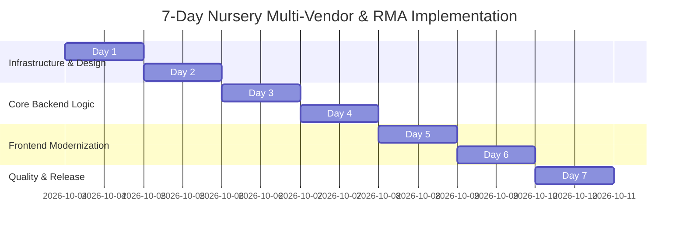

# 7-Day Master Roadmap: Multi-Vendor Nursery Marketplace & Returns System

> **Project**: Nursery & Botanical eCommerce Marketplace with Multi-Vendor & RMA  
> **Frontend**: Next.js 15 (App Router, React 18, TailwindCSS, DaisyUI, Zustand)  
> **Backend**: Node.js (Express 4, CommonJS), MySQL 8.0 (Dockerized), Prisma ORM 6.16  
> **Primary Theme**: Modern Botanical Teal (`#0D9488` / `#0F766E`) with Single-File Theming Architecture  
> **Core Architecture Constraint**: **Zero disruption to existing features, schema, and API contracts.**

---

## 1. Executive Summary & Vision

This roadmap transitions the platform from an electronics demo shop into a **production-ready Multi-Vendor Nursery Marketplace** (indoor plants, fruit saplings, exotic seeds, planters, organic soils, fertilizers, gardening equipment) with a specialized **Order Return & Refund (RMA)** engine.

### Key Pillars of the Transformation:
1. **Containerized Database**: Run a dedicated MySQL 8.0 Docker container with persistent volumes, automated health checks, and instant startup scripts.
2. **Centralized Single-File Theme Engine**: Implement a CSS variables + Tailwind token design system configured entirely within `theme.config.ts`. Swapping the palette from **Botanical Teal** to any brand palette takes 5 seconds by editing a single file.
3. **Nursery Multi-Vendor Architecture**: Enable nurseries and plant growers to manage their inventory, plant-specific metadata (light, watering, toxicity, pot size), live shipping updates, and track merchant payouts.
4. **Perishable-Aware Return System (RMA)**: Differentiate return policies between live perishable plants (photo proof required within 48–72 hours) and non-perishable garden tools/pots (standard 14–30 days).
5. **Human Review Gates**: Every day concludes with explicit, interactive verification gates that a human reviewer must sign off on before proceeding.
6. **Extensive Automated Test Suite**: Comprehensive unit, integration, and state-machine test cases covering vendor isolation, order splitting, and return workflows.

---

## 2. 7-Day Plan Overview at a Glance

| Day | File | Focus Area | Deliverables | Human Review Gate |
| :--- | :--- | :--- | :--- | :--- |
| **Day 1** | [`tasks/day-1-docker-db-and-theme-system.md`](file:///c:/Users/lokes/Desktop/Electronics-eCommerce-Shop-With-Admin-Dashboard-NextJS-NodeJS/tasks/day-1-docker-db-and-theme-system.md) | **Docker DB & Teal Theme** | `docker-compose.yml`, MySQL container, `theme.config.ts`, CSS tokens, Tailwind wiring. | Verify DB connection + Single-file color change test. |
| **Day 2** | [`tasks/day-2-nursery-domain-and-schema-migration.md`](file:///c:/Users/lokes/Desktop/Electronics-eCommerce-Shop-With-Admin-Dashboard-NextJS-NodeJS/tasks/day-2-nursery-domain-and-schema-migration.md) | **Nursery Domain & Schema** | Botanical extensions, non-breaking Prisma migrations, seed script with nursery items. | Verify existing products intact + New plant fields queryable. |
| **Day 3** | [`tasks/day-3-auth-rbac-and-vendor-sub-orders.md`](file:///c:/Users/lokes/Desktop/Electronics-eCommerce-Shop-With-Admin-Dashboard-NextJS-NodeJS/tasks/day-3-auth-rbac-and-vendor-sub-orders.md) | **Vendor RBAC & Order Split** | NextAuth vendor role, Express scope middleware, background order splitter hook. | Test multi-vendor checkout; verify sub-orders generated. |
| **Day 4** | [`tasks/day-4-returns-and-rma-engine.md`](file:///c:/Users/lokes/Desktop/Electronics-eCommerce-Shop-With-Admin-Dashboard-NextJS-NodeJS/tasks/day-4-returns-and-rma-engine.md) | **Returns & RMA Engine** | RMA state machine, perishable photo upload, restocking & payout adjustment hooks. | Test return submission, vendor approval, and stock increment. |
| **Day 5** | [`tasks/day-5-modern-teal-ui-transformation.md`](file:///c:/Users/lokes/Desktop/Electronics-eCommerce-Shop-With-Admin-Dashboard-NextJS-NodeJS/tasks/day-5-modern-teal-ui-transformation.md) | **Storefront UI Modernization** | Header, Hero, Category Cards, Product Cards, Cart in botanical Teal palette. | Visual inspection of responsive storefront + color switcher. |
| **Day 6** | [`tasks/day-6-vendor-portal-and-customer-rma-ui.md`](file:///c:/Users/lokes/Desktop/Electronics-eCommerce-Shop-With-Admin-Dashboard-NextJS-NodeJS/tasks/day-6-vendor-portal-and-customer-rma-ui.md) | **Vendor Portal & RMA UI** | `/vendor/*` dashboard, `/account/orders`, return request wizard modal. | Vendor logs in, sees only their products/orders & approves return. |
| **Day 7** | [`tasks/day-7-testing-suite-and-human-review-gates.md`](file:///c:/Users/lokes/Desktop/Electronics-eCommerce-Shop-With-Admin-Dashboard-NextJS-NodeJS/tasks/day-7-testing-suite-and-human-review-gates.md) | **Test Suite & Final Audit** | Unit & Integration tests, E2E check, security audit, deployment sign-off. | Complete Human Review checklist verification. |

---

## 3. Human Review Protocol

At the end of each day's execution, a **Human Review Gate** is enforced:
1. **Automated Check**: All tests for that day pass (`npm run test`).
2. **Backward-Compatibility Check**: Run legacy smoke test (create standard order, browse catalog, verify zero regressions).
3. **Interactive Human Sign-Off**: The human reviewer reviews the acceptance checklist in the day's markdown document and signs off before proceeding.
